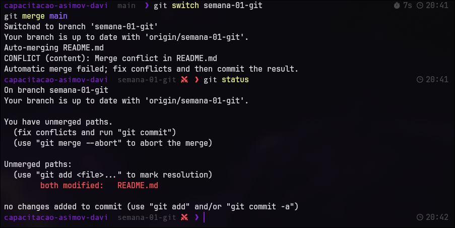
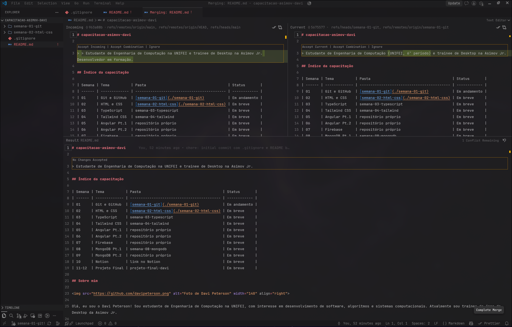

# Semana 01: Git e GitHub

## O que foi feito

- Criação do repositório público `capacitacao-asimov-davi`, com `.gitignore` e README base no primeiro commit na `main`.
- Estrutura de pastas por semana (`semana-01-git`, `semana-02-html-css`) e índice das semanas no README principal.
- Currículo no README principal (sobre mim, formação, habilidades e contatos).
- Fluxo de trabalho com branches e Pull Requests, mais um conflito de merge provocado e resolvido.
- Commits pequenos no padrão Conventional Commits.

## Como rodar

Não há código para executar nesta semana. Para visualizar, abra o [README principal](../README.md) no GitHub, ou clone o repositório:

```bash
git clone https://github.com/davipeterson/capacitacao-asimov-davi.git
```

## Link publicado

- Repositório: https://github.com/davipeterson/capacitacao-asimov-davi

## Fluxo de branches

| Branch                  | Para que serve                               | Integração |
| ----------------------- | -------------------------------------------- | ---------- |
| `main`                  | Versão estável do repositório                |            |
| `feat/estrutura-pastas` | Pastas por semana e índice                   | PR #4      |
| `fix/ajusta-frase`      | Ajuste da frase de apresentação              | PR #5      |
| `semana-01-git`         | Entrega da semana (currículo e documentação) | PR final   |

## Conflito de merge

**Como provoquei:** a `semana-01-git` e a `fix/ajusta-frase` partiram da mesma `main` e alteraram **a mesma linha** do `README.md` (a frase de apresentação, logo abaixo do título). Integrei primeiro a `fix/ajusta-frase` à `main` pelo PR #5. Depois, ao rodar `git merge main` na `semana-01-git`, o Git não soube qual versão manter e interrompeu o merge:

```text
Auto-merging README.md
CONFLICT (content): Merge conflict in README.md
Automatic merge failed; fix conflicts and then commit the result.
```



**Como resolvi:** abri o arquivo no editor de merge do VS Code, que mostra as duas versões lado a lado. Mantive a versão da minha branch. Também percebi que a versão da `main` tinha um `>` duplicado na linha, que formaria uma citação aninhada, e corrigi para um único `>`.



Depois de resolver, finalizei com:

```bash
git add README.md
git commit -m "fix: resolve conflito de merge na frase de apresentacao"
git push
```

## Commits

Segui o padrão Conventional Commits (`feat:`, `fix:`, `docs:`, `chore:`), com commits pequenos que descrevem uma única mudança, por exemplo `docs: adiciona secao de contatos`.

## Dificuldades encontradas

Não tive grandes dificuldades, porque já uso Git há alguns anos. O que exigiu atenção foi planejar a ordem das branches e dos merges para provocar o conflito de propósito, e revisar o resultado: ao resolver, percebi que a versão da `main` tinha um `>` duplicado na frase de apresentação, e corrigi na resolução.

## Bônus

- README de perfil: [davipeterson/davipeterson](https://github.com/davipeterson/davipeterson)
- Issues vinculadas aos Pull Requests (`Closes #N`)
- Tag e release `v0.1`
