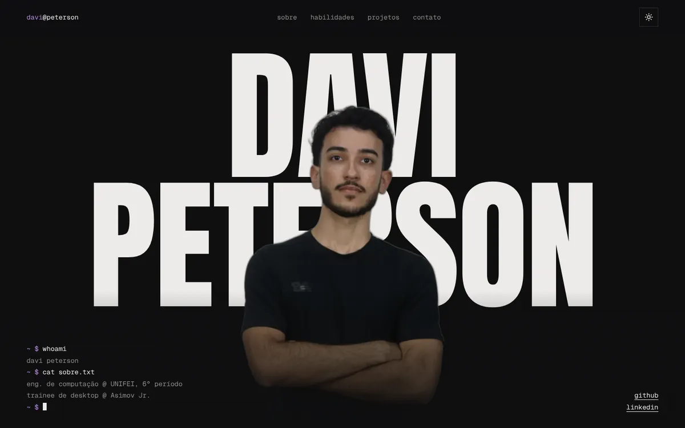
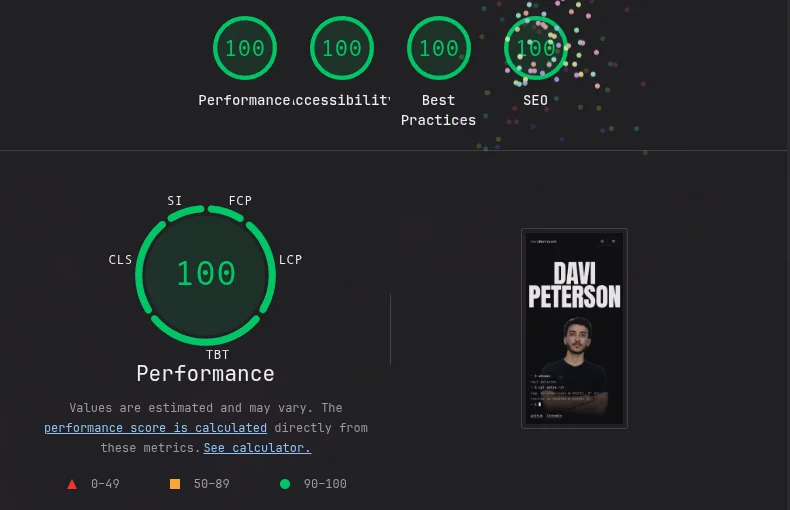

# Semana 02: HTML e CSS

Portfólio pessoal feito do zero com HTML semântico, CSS puro e um pouco de JavaScript, publicado no GitHub Pages.

**Site publicado:** https://davipeterson.github.io/capacitacao-asimov-davi/semana-02-html-css/



## O que foi feito

- **Seções:** início (hero), sobre, habilidades, projetos (com espaço para os próximos) e contato.
- **HTML semântico:** `header`, `nav`, `main`, `section`, `article`, `figure`, `dl`, `address`, `footer`, além de `kbd` e `samp` no bloco de terminal.
- **Layout responsivo:** CSS Grid nas seções e nos projetos, Flexbox no cabeçalho e no carrossel, media queries para celular e tamanhos fluidos com `clamp()`.
- **CSS externo e organizado** em 4 arquivos, com variáveis para cores, fontes e espaçamentos.
- **Imagens com `alt`**, em `.webp`, com `width`/`height` e `loading="lazy"` abaixo da dobra.

### Bônus

- **Modo escuro e claro:** o escuro é o padrão. O botão de sol e lua alterna o tema, e a escolha fica salva no `localStorage`.
- **Animações sutis:** entrada do nome e da foto, cursor piscando no terminal e carrossel de tecnologias em loop feito só com CSS. Tudo desliga para quem ativa "reduzir movimento" no sistema.
- **Lighthouse acima de 90**, verificado automaticamente a cada Pull Request:

| Performance | Acessibilidade | Boas práticas | SEO |
| :---------: | :------------: | :-----------: | :-: |
|     100     |      100       |      100      | 100 |



### Extras

- Menu mobile acessível (`aria-expanded`, fecha com Esc).
- Link "pular para o conteúdo" e foco visível em todos os elementos interativos.
- Meta tags de SEO e Open Graph, favicon em SVG e `theme-color` que acompanha o tema.
- CI/CD com GitHub Actions: validação de HTML e CSS, Lighthouse com nota mínima 90 e deploy automático no GitHub Pages.

## Como rodar

Não precisa instalar nada para ver o site. Clone o repositório e abra o `index.html` desta pasta no navegador:

```bash
git clone https://github.com/davipeterson/capacitacao-asimov-davi.git
cd capacitacao-asimov-davi
xdg-open semana-02-html-css/index.html
```

Para rodar os validadores (precisa de Node 18 ou mais):

```bash
npm install
npm run lint
```

## Estrutura

```text
semana-02-html-css
├── index.html
├── css
│   ├── variables.css    tokens de cor, fonte e espaçamento + tema claro
│   ├── base.css         fontes locais, reset e acessibilidade
│   ├── layout.css       cabeçalho, hero, grid das seções e media queries
│   └── components.css   botões, carrossel, habilidades, projetos e animações
├── js
│   └── main.js          tema escuro/claro e menu mobile
└── assets
    ├── fonts            Anton, Geist e Geist Mono em woff2
    ├── img              fotos em webp e favicon
    └── docs             imagens deste README
```

## Decisões técnicas

| Decisão                                                  | Por quê                                                                                                                                                          |
| -------------------------------------------------------- | ---------------------------------------------------------------------------------------------------------------------------------------------------------------- |
| Fontes hospedadas no repositório, em vez do Google Fonts | Sem dependência externa e sem requisição a outro domínio, o que melhora a performance. O `preload` das duas fontes principais evita o texto "pular" ao carregar. |
| Logos do carrossel num sprite SVG (`<symbol>` + `<use>`) | O carrossel repete a lista para o loop ficar contínuo. Com o sprite, cada logo é desenhada uma vez só, e o HTML caiu de 65 KB para 40 KB.                        |
| Segunda lista do carrossel com `aria-hidden="true"`      | O leitor de tela lê as tecnologias uma vez, não duas.                                                                                                            |
| `kbd`, `samp`, `dl`, `article` e `address`               | Cada tag diz o que o conteúdo é: comando digitado, saída do programa, termo e definição, conteúdo independente e contato do autor.                               |
| Classes no padrão BEM (`bloco__elemento--modificador`)   | Nomes previsíveis e sem conflito. O stylelint obriga o padrão.                                                                                                   |
| Tema por `data-theme` no `<html>`                        | O tema claro só redefine as variáveis de cor. Nenhuma regra de componente precisa saber qual tema está ativo.                                                    |
| `main.js` no `<head>` sem `defer`                        | Aplica o tema salvo antes da primeira pintura, então a página não "pisca" no tema errado.                                                                        |
| Fotos em `.webp`, com o fundo da foto principal removido | As duas fotos somam cerca de 43 KB.                                                                                                                              |
| `srcset` e `sizes` nas fotos, com versões de 480 px      | O navegador baixa a menor imagem que fica nítida na tela, resolvendo o aviso "Improve image delivery" do Lighthouse.                                             |

## Fluxo de trabalho

Cada etapa teve uma issue, uma branch própria e um Pull Request para a `semana-02-html-css`, com commits no padrão Conventional Commits e com escopo (`feat(html)`, `feat(css)`, `ci`):

| Branch                     | Pull Request | Issue    |
| -------------------------- | ------------ | -------- |
| `feat/html-estrutura`      | #13          | #7       |
| `feat/css-estilos`         | #14          | #8, #10  |
| `feat/js-tema-menu`        | #15          | #9       |
| `ci/qualidade-deploy`      | #16          | #10, #11 |
| `docs/readme-semana-02`    | #17          | #12      |
| `perf/imagens-responsivas` | #18          | #11      |

## Dificuldades encontradas

A maior dificuldade foi chegar na direção visual. Passei por várias ideias até chegar no estilo final, inspirado em referências do Dribbble, e escolher a tipografia levou tempo. Na parte técnica, as fontes do Google Fonts não carregavam em alguns ambientes, então passei a hospedá-las no próprio repositório. Também aprendi a deixar ferramentas apontarem erros que passam no olho: o stylelint encontrou 7 problemas no CSS que eu corrigi com --fix.
